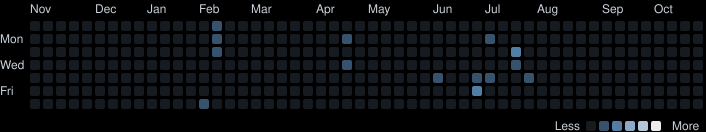

### Olá! Eu sou o Luan 👋


[](https://wakatime.com/@13ba27f0-fb5f-46cf-ad72-5c001ac27bef)


<a href="https://wakatime.com/@13ba27f0-fb5f-46cf-ad72-5c001ac27bef"></a>

- 🔭 Atualmente trabalhando na [Pismo](https://www.pismo.io/) (a Visa company) como Site Reliability Engineer.
- 🌱 Meu foco atualmente está em aplicar minha experiência em Linux, redes, automação, cloud e observabilidade para desenvolver soluções escaláveis, seguras e inovadoras.
- 📫 Contate-me no email: luanmw0@gmail.com


## Redes Sociais

<div> 
 
  <a href="https://www.linkedin.com/in/luan-wendling/" target="_blank"></a>
  <a href = "luanmw0@gmail.com"></a>
    
</div>


## 📊 Development Analytics

### ⏱️ Coding Activity — Last 7 Days

Weekly coding activity automatically tracked by WakaTime.

<!--START_SECTION:waka-->

```txt
From: 25 October 2026 - To: 31 October 2026

Total Time: 8 hrs 40 mins

Markdown     2 hrs 49 mins    ████████░░░░░░░░░░░░░░░░░    32.57 %
Python       2 hrs 40 mins    ████████░░░░░░░░░░░░░░░░░    30.86 %
JavaScript   1 hrs 5 mins     ███░░░░░░░░░░░░░░░░░░░░░░    12.51 %
TypeScript   0 hrs 48 mins    ██░░░░░░░░░░░░░░░░░░░░░░░     9.32 %
Other        0 hrs 27 mins    █░░░░░░░░░░░░░░░░░░░░░░░░     5.22 %
Java         0 hrs 11 mins    █░░░░░░░░░░░░░░░░░░░░░░░░     2.24 %
CSS          0 hrs 8 mins     ░░░░░░░░░░░░░░░░░░░░░░░░░     1.55 %
PowerShell   0 hrs 7 mins     ░░░░░░░░░░░░░░░░░░░░░░░░░     1.41 %
HTML         0 hrs 6 mins     ░░░░░░░░░░░░░░░░░░░░░░░░░     1.24 %
MQL          0 hrs 4 mins     ░░░░░░░░░░░░░░░░░░░░░░░░░     0.94 %
```

<!--END_SECTION:waka-->

---
*Statistics updated automatically via GitHub Actions.*
