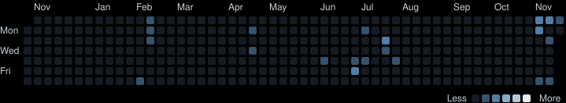

### Olá! Eu sou o Luan 👋


[](https://wakatime.com/@13ba27f0-fb5f-46cf-ad72-5c001ac27bef)


<a href="https://wakatime.com/@13ba27f0-fb5f-46cf-ad72-5c001ac27bef"></a>

- 🔭 Atualmente trabalhando na [Pismo](https://www.pismo.io/) (a Visa company) como Site Reliability Engineer.
- 🌱 Meu foco atualmente está em aplicar minha experiência em Linux, redes, automação, cloud e observabilidade para desenvolver soluções escaláveis, seguras e inovadoras.
- 📫 Contate-me no email: luanmw0@gmail.com


## Redes Sociais

<div> 
 
  <a href="https://www.linkedin.com/in/luan-wendling/" target="_blank"></a>
  <a href = "luanmw0@gmail.com"></a>
    
</div>


## 📊 Development Analytics

### ⏱️ Coding Activity — Last 7 Days

Weekly coding activity automatically tracked by WakaTime.

<!--START_SECTION:waka-->

```txt
From: 09 November 2026 - To: 15 November 2026

Total Time: 8 hrs 28 mins

TypeScript   2 hrs 46 mins    ████████░░░░░░░░░░░░░░░░░    32.85 %
JavaScript   1 hrs 32 mins    █████░░░░░░░░░░░░░░░░░░░░    18.26 %
HTML         1 hrs 17 mins    ████░░░░░░░░░░░░░░░░░░░░░    15.33 %
Markdown     1 hrs 5 mins     ███░░░░░░░░░░░░░░░░░░░░░░    12.98 %
Other        1 hrs 5 mins     ███░░░░░░░░░░░░░░░░░░░░░░    12.87 %
Python       0 hrs 14 mins    █░░░░░░░░░░░░░░░░░░░░░░░░     2.87 %
CSS          0 hrs 11 mins    █░░░░░░░░░░░░░░░░░░░░░░░░     2.24 %
Git Config   0 hrs 10 mins    █░░░░░░░░░░░░░░░░░░░░░░░░     2.03 %
SQL          0 hrs 1 mins     ░░░░░░░░░░░░░░░░░░░░░░░░░     0.32 %
JSON         0 hrs 0 mins     ░░░░░░░░░░░░░░░░░░░░░░░░░     0.14 %
```

<!--END_SECTION:waka-->

---
*Statistics updated automatically via GitHub Actions.*
